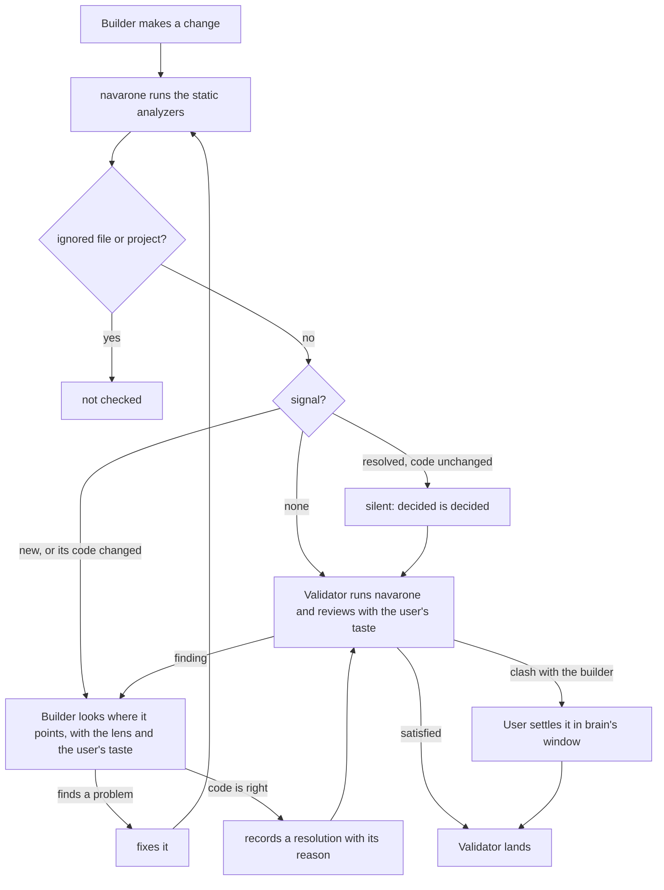

# Navarone's process: a signal points, the builder looks, the validator reviews with the user's taste, and the user settles a clash

Navarone is a tool baked into the process, and it holds no LLM. It runs static analyzers, and each finding is a signal: a reason to look, never a verdict and never the solution. The judgement lives in the agents and in the user.

1. The builder makes a change and runs Navarone. Files and projects the repo ignores are not checked.
2. A signal that was resolved, on code that has not changed, stays silent: when something has been decided, it has been decided. Touching the code opens it again.
3. A new signal sends the builder to look where it points, with the lens and the user's taste. It fixes what it finds and runs Navarone again, or it holds that the code is right and records a resolution with its reason.
4. The validator runs Navarone too, and reviews the work with the user's taste injected: the validator is the taste judge. It sends its findings back to the builder until it is satisfied.
5. When the builder and the validator clash, the user is the judge. He settles it in brain's window, and his answer becomes the resolution.
6. The validator lands the work.

## Why
A signal is never the solution: it only says where the discipline may have slipped, so the judgement stays with the agents and the user, and Navarone holds no LLM.

## Edges
- part-of -> thesis
